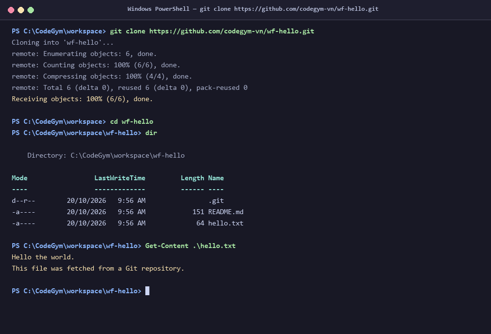

# [Thực hành] Clone dự án từ Git

## 1. Mục tiêu bài thực hành
- Luyện tập và nắm vững thao tác cơ bản nhất khi làm việc với Git: Sao chép (Clone) một Remote Repository từ GitHub về máy tính cá nhân (Local Machine).
- Hiểu rõ cú pháp, cơ chế hoạt động và ý nghĩa của lệnh `git clone`.
- Thực hành trực tiếp clone dự án mẫu `wf-hello` từ CodeGym và kiểm tra cấu trúc tập tin nhận được.

---

## 2. Cú pháp và ý nghĩa của lệnh `git clone`

### 2.1 Cú pháp cơ bản
```bash
git clone <url-repository>
```
*Ví dụ:*
```bash
git clone https://github.com/codegym-vn/wf-hello.git
```

### 2.2 Các tùy chọn cú pháp mở rộng
| Lệnh mở rộng | Mục đích sử dụng |
| :--- | :--- |
| `git clone <url> <ten-thu-muc>` | Sao chép repository về và đổi tên thư mục đích theo ý muốn thay vì tên mặc định. |
| `git clone -b <ten-nhanh> <url>` | Chỉ định checkout trực tiếp vào một branch cụ thể sau khi clone. |
| `git clone --depth 1 <url>` | Shallow clone – chỉ tải về commit mới nhất, giảm dung lượng và tăng tốc độ tải dự án lớn. |
| `git clone --single-branch <url>` | Chỉ tải lịch sử commit của đúng 1 nhánh duy nhất. |

### 2.3 Ý nghĩa và cơ chế hoạt động của `git clone`
1. **Tải toàn bộ dữ liệu dự án:** Khác với việc chỉ tải file `.zip`, `git clone` tải toàn bộ lịch sử commit, tất cả các nhánh (branches), tags và đối tượng trong cơ sở dữ liệu của Git.
2. **Tự động cấu hình Local Repository:** Lệnh tự động tạo thư mục ẩn `.git`, biến thư mục đích thành một Git Repository hoàn chỉnh tại máy local.
3. **Tự động thiết lập Remote tracking (`origin`):** Tự động liên kết remote name mặc định là `origin` trỏ đến địa chỉ URL từ xa, giúp bạn có thể dùng các lệnh `git pull` hoặc `git push` ngay sau đó.
4. **Tự động Checkout nhánh chính:** Git sẽ tự động giải nén mã nguồn của nhánh mặc định (`main` hoặc `master`) ra Working Directory để bạn có thể bắt đầu làm việc ngay.

---

## 3. Các bước thực hiện thực hành

- **Bước 1:** Truy cập repository mẫu tại địa chỉ: `https://github.com/codegym-vn/wf-hello`
- **Bước 2:** Nhấn nút **Code** (hoặc Clone or download) và copy URL: `https://github.com/codegym-vn/wf-hello.git`
- **Bước 3:** Mở màn hình Terminal / PowerShell trên máy tính, di chuyển đến thư mục làm việc mong muốn.
- **Bước 4:** Thực thi lệnh clone:
  ```bash
  git clone https://github.com/codegym-vn/wf-hello.git
  ```
- **Bước 5:** Di chuyển vào thư mục vừa clone và kiểm tra danh sách file:
  ```bash
  cd wf-hello
  dir   # Trên Windows PowerShell / Command Prompt
  ls -la # Trên Linux / macOS
  ```

---

## 4. Kết quả kiểm tra nội dung file sau khi Clone

Trong thư mục `wf-hello` bao gồm 2 file mã nguồn:

### Nội dung file `README.md`:
```markdown
# wf-hello
Git Hello world example for Codegym.
#
Mã nguồn wf-hello được sử dụng để thực hành tại [CodeGym](https://codegym.vn)
```

### Nội dung file `hello.txt`:
```text
Hello the world.
This file was fetched from a Git repository.
```

---

## 5. Ảnh chụp kết quả thực hành Terminal
Dưới đây là hình ảnh chụp màn hình ghi lại toàn bộ quá trình thực hiện câu lệnh `git clone`, chuyển thư mục và xem nội dung file:


*(File ảnh: `git_clone_result.png` - Dung lượng ~63 KB, định dạng PNG chuẩn chất lượng cao).*
